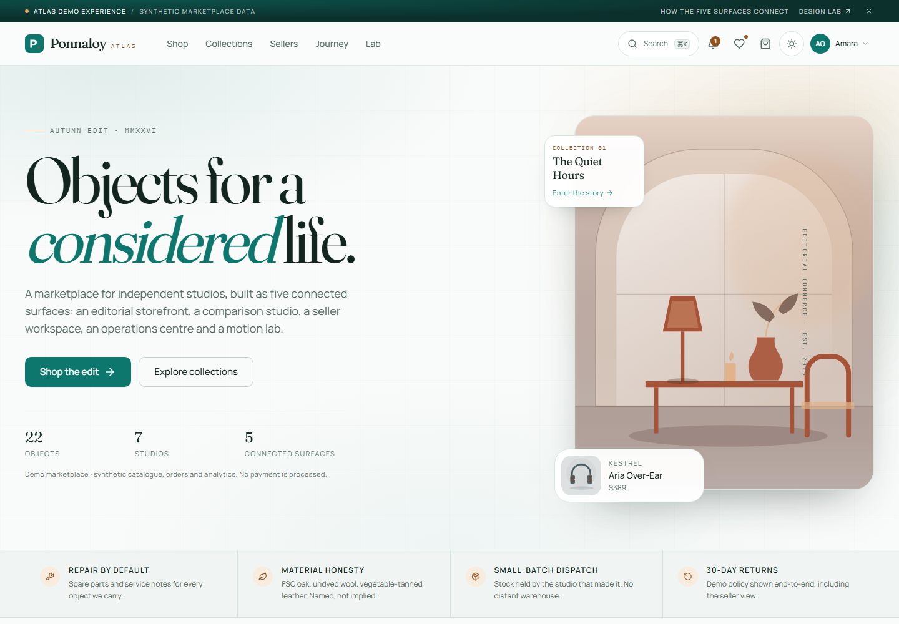

<div align="center">

# Ponnaloy Atlas

**Editorial commerce. Connected marketplace operations. One shared design system.**

A multi-vendor marketplace frontend built with Next.js, React, and TypeScript, bringing product discovery, customer journeys, seller tools, and administrative workflows into one application.

[Live Demo](https://ponnaloy-atlas.vercel.app/) · [Features](#features) · [Run Locally](#getting-started) · [Architecture](docs/ARCHITECTURE.md)


</div>

<picture>
  <source media="(prefers-color-scheme: dark)" srcset="artifacts/aura/home-dark.png">
  <source media="(prefers-color-scheme: light)" srcset="artifacts/aura/home-light.png">
  
</picture>

> **Demo application:** Atlas uses synthetic catalogue, customer, order, and analytics data. Marketplace changes persist in your browser. Sign-in and role switching are simulated, and no payment is processed. Do not enter real payment details.

## Overview

Atlas demonstrates the frontend of a marketplace beyond the storefront. Customers can discover and compare products, build a basket, complete a simulated checkout, and follow an order. Sellers can manage listings, inventory, and fulfilment. Administrators can moderate products, review customers, manage returns, and curate the homepage.

These workflows share typed domain models, browser-persisted state, reusable components, and the **Aura design system**: ivory and deep teal in light mode, midnight forest and luminous teal in dark mode, with editorial typography and restrained motion.

## Features

### Storefront and customer experience

- Editorial homepage with collections, category discovery, product rails, and studio profiles.
- Search dialog with a keyboard shortcut, catalogue search, and URL-based filters.
- Product details with variant selection, quantity controls, availability, and related products.
- Quick view, persistent wishlist, cart drawer, and shopping basket.
- Side-by-side comparison with difference-only filtering, variant selection, keyboard reordering, and direct add-to-cart.
- Validated demo checkout, order history, shipment timelines, return requests, and notifications.

### Seller workspace

- Overview metrics, revenue charts, analytics, and earnings.
- Product creation and editing, inline inventory updates, and low-stock policies.
- Order management, fulfilment updates, and studio settings.

### Admin workspace

- Catalogue moderation, product management, seller directory, and customer search.
- Order operations, returns and refunds, financial summaries, and CSV export.
- Homepage merchandising, analytics, audit history, and platform settings.

### Design and interaction

- Persistent **Light / Dark / System** appearance controls.
- **Full / Reduced / Minimal** motion profiles, with device reduced-motion preferences respected.
- Semantic color tokens, visible focus states, and Radix-based dialogs and drawers.
- Responsive storefront and workspace navigation, touch-friendly controls, and scrollable data interfaces.
- A design and motion lab for exploring typography, tokens, components, charts, and interactions.
- Original local SVG product artwork and editorial illustrations.

## Explore the application

| Experience | Routes | Focus |
| --- | --- | --- |
| Storefront and customer journeys | `/`, `/products`, `/product/[slug]`, `/collections`, `/sellers`, `/cart`, `/checkout`, `/orders`, `/account`, `/wishlist` | Discovery, purchase simulation, and post-purchase interactions |
| Comparison studio | `/compare` | Product attributes, differences, variants, and selection |
| Seller workspace | `/seller` and its subroutes | Listings, stock, orders, earnings, and analytics |
| Admin command centre | `/admin` and its subroutes | Moderation, customers, finance, merchandising, and operations |
| Design and motion lab | `/lab` | Design-system reference and interaction specimens |

The [connected journey](https://ponnaloy-atlas.vercel.app/journey) follows an order across customer, seller, and admin contexts.

To explore a workspace, use the account role switcher or the **Preview as seller** / **Preview as administrator** action on its entry page. These controls change the demo role; they do not provide production authentication or authorization.

## Technology

| Layer | Tools |
| --- | --- |
| Application | Next.js 15.5 App Router, React 19, TypeScript |
| Styling and themes | Tailwind CSS 3.4, semantic HSL variables, next-themes |
| UI components | Radix UI, Class Variance Authority, Lucide icons |
| Motion | Framer Motion 11, CSS transitions, IntersectionObserver |
| Forms and validation | React Hook Form, Zod |
| State | React `useSyncExternalStore`, local component state, URL search parameters |
| Charts and artwork | Custom SVG components |
| Testing | Vitest, Testing Library, Playwright, axe-core |
| Hosting | Vercel |

## Getting started

### Requirements

- Node.js **20 or later**.
- [pnpm](https://pnpm.io/).

### Install and run

```bash
git clone https://github.com/limon-l/Ponnaloy-atlas.git
cd Ponnaloy-atlas
pnpm install --frozen-lockfile
pnpm dev
```

Open [localhost:3000](http://localhost:3000). The default demo requires no environment variables, database, backend service, or payment credentials.

For a local production server:

```bash
pnpm build
pnpm start
```

### Try a complete workflow

1. Browse the catalogue, open a product, and choose a variant.
2. Add it to the bag and continue through the simulated checkout.
3. Use `4242 4242 4242 4242` if exploring the demo card form; no charge is made.
4. Open the resulting order, then explore seller and admin workflows through role preview.
5. Change an inventory value or homepage feature selection and revisit the storefront to see the shared state update.

### Demo data and reset

The initial dataset contains **25 products** (22 approved and 3 awaiting moderation), **7 studios**, and **60 orders**. The demo customer is **Amara Okafor**. Seeded dates use a fixed demo clock, so they are not a live view of current trading activity.

Marketplace state is stored locally under `ponnaloy.atlas.state.v1`. It is isolated to each browser and origin and is not shared between visitors. Reset it through **Account → Demo data → Reset demo state** or **Admin → Settings → Reset demo**.

Appearance and motion preferences are stored separately and remain after a marketplace reset.

## Architecture

```text
src/
├── app/
│   ├── (store)/             Storefront and customer routes
│   ├── seller/              Seller workspace and guarded layout
│   ├── admin/               Admin workspace and guarded layouts
│   ├── globals.css          Theme, typography, and motion tokens
│   └── layout.tsx           Root layout, fonts, and providers
├── components/
│   ├── ui/                  Shared interface primitives
│   ├── store/               Header, search, cart, account, and footer
│   ├── workspace/           Workspace shell, metrics, and panels
│   └── ...                  Product cards, artwork, charts, and reveals
└── lib/                     Types, store, seed data, domain logic, and API transport

e2e/                        Browser journeys and accessibility checks
scripts/                    Local performance measurement
artifacts/aura/              Screenshots and recorded validation results
docs/                       Architecture, design, testing, and implementation notes
```

State ownership follows three boundaries: the external store owns persisted demo marketplace data, components own temporary interface state, and URL parameters own catalogue filtering. Shared domain utilities handle pricing, comparisons, validation, and analytics. See the [architecture guide](docs/ARCHITECTURE.md) for module boundaries and data flow.

### API integration boundary

[`src/lib/api.ts`](src/lib/api.ts) contains a typed request helper and endpoint wrappers for the original Ponnaloy API. **The current UI still reads from the seeded catalogue and browser store. The transport is not wired into those workflows.**

| Variable | Default | Current purpose |
| --- | --- | --- |
| `NEXT_PUBLIC_ATLAS_DATA_MODE` | `demo` | Sets the displayed data-mode label; setting `live` does not connect the UI to a backend |
| `NEXT_PUBLIC_API_URL` | `http://localhost:3001` | Base URL used by the API transport when called |

Completing live integration requires connecting data hooks and mutations, implementing real authentication and server-side permissions, and validating the backend and payment flows. These are not part of the deployed demo. Variables prefixed with `NEXT_PUBLIC_` are public client configuration and must not contain secrets.

## Development and verification

| Command | Purpose |
| --- | --- |
| `pnpm dev` | Start the development server |
| `pnpm build` | Create the production build |
| `pnpm start` | Serve a completed production build |
| `pnpm typecheck` | Check TypeScript |
| `pnpm lint` | Run Next.js lint checks |
| `pnpm test` | Run unit and domain tests |
| `pnpm test:watch` | Run Vitest in watch mode |
| `pnpm verify` | Run type checking, lint, unit tests, and production build |
| `pnpm e2e:install` | Install the Chromium browser for Playwright |
| `pnpm e2e` | Run browser tests against a completed build |
| `pnpm e2e:ci` | Build, then run the browser suite |
| `pnpm perf:lab` | Measure local production LCP, CLS, and resource transfer |

For the browser suite:

```bash
pnpm e2e:install
pnpm e2e:ci
```

Playwright starts the production server on port 3000 when needed and reuses an existing server outside CI. Ensure any reused server serves the build you intend to test.

### Recorded validation

The latest recorded local validation on **31 October 2026** includes:

| Check | Result | Evidence |
| --- | --- | --- |
| TypeScript and production build | Passed | [Aura implementation report](docs/AURA-IMPLEMENTATION.md) |
| Unit and domain tests | **43 passed** | [Validation record](docs/AURA-IMPLEMENTATION.md#final-validation-matrix) |
| Chromium end-to-end suite | **55 passed** | [Browser results](artifacts/aura/browser-results.txt) |
| Automated accessibility | **22 axe scans passed** within the browser suite | [Route checks](e2e/a11y.spec.ts) and [light/dark checks](e2e/aura.spec.ts) |
| Responsive overflow | **28 checks passed** across 320–1920px | [Responsive results](artifacts/aura/responsive.json) |
| Theme and motion behavior | Persistence, System updates, and reduced-motion checks passed | [Aura browser tests](e2e/aura.spec.ts) |

Accessibility checks target serious and critical axe violations on the covered routes and states. They do not establish full WCAG conformance. Baseline screenshot comparisons and an exhaustive manual screen-reader review have not been performed.

### Performance measurements

The latest [local performance results](artifacts/aura/performance.tsv) cover six routes with desktop and mobile profiles:

| Metric | Observed range |
| --- | --- |
| Largest Contentful Paint (LCP) | **188–824ms** |
| Cumulative Layout Shift (CLS) | **0–0.0346** |
| Interaction to Next Paint (INP) | Not measured |

Measurements use a production build, headless Chromium, a fresh browser context per sample, and no CPU or network throttling. These are localhost lab results, not measurements of the Vercel deployment or field Core Web Vitals.

To reproduce, run the server in one terminal:

```bash
pnpm build
pnpm start -p 3100
```

Then measure from a second terminal:

```bash
pnpm perf:lab
```

## Documentation

| Document | Contents |
| --- | --- |
| [Architecture](docs/ARCHITECTURE.md) | Routes, state ownership, domain modules, and integration boundaries |
| [Design system](docs/DESIGN-SYSTEM.md) | Typography, tokens, components, and motion |
| [Aura implementation](docs/AURA-IMPLEMENTATION.md) | Frontend audit, upgrade matrix, refinements, and latest validation |
| [Testing guide](docs/TESTING.md) | Automated scenarios and manual review procedures |
| [Performance report](docs/PERFORMANCE.md) | Earlier measurements, methodology, and layout-shift investigation; current results are linked above |
| [Case study](docs/CASE-STUDY.md) | Design decisions, engineering tradeoffs, and project context |
| [Demo walkthrough](docs/DEMO-SCRIPT.md) | Suggested walkthrough of the connected experiences |
| [Original repository audit](docs/AUDIT.md) | Historical findings from the original Ponnaloy codebase |

## Project scope

Atlas is a deployed frontend demonstration. Authentication, payments, financial settlements, and marketplace records are simulated. Browser state is not a backend or a shared database, and frontend role gates are not a security boundary. Production use requires a connected backend and independent verification of authentication, authorization, payments, and operational behavior.

Explore the application at **[ponnaloy-atlas.vercel.app](https://ponnaloy-atlas.vercel.app/)**.
